# ⚡ ShamelessCompany
### *High-Impact Digital Production & Open Innovation Studio*
#### Monorepositorio y Cuartel General de 24 Proyectos | 6 Personas | 3 Células Ágiles

---

## 🌎 Sobre ShamelessCompany / About Us

**[ES]** **ShamelessCompany** es un estudio independiente y laboratorio de software fundado bajo una regla estricta: **Cero Humo (*Zero Buzzwords*) y Cero Costo de Infraestructura (`$0 USD/mes`)**. Operamos como una cooperativa de alto rendimiento compuesta por **6 profesionales distribuidos en 3 células especializadas**, apalancando el pool de herramientas de GitHub Student Developer Pack, Cloudflare Serverless, nodos Oracle ARM Always Free y motores de código abierto (Godot 4, Blender, Rust/Tauri).

**[EN]** **ShamelessCompany** is an independent production studio and software laboratory operated under a strict principle: **Zero Buzzwords, Zero Monthly Overhead (`$0 USD/mo`)**. We operate as a high-velocity collective of **6 builders organized into 3 cross-functional squads**, leveraging the GitHub Student Developer Pack, Cloudflare Serverless Edge, Oracle ARM 24GB Always Free compute, and open-source engines (Godot 4, Blender, Rust/Tauri).

---

## 🏛️ Estructura del Estudio: 24 Repositorios y 3 Células

```mermaid
flowchart TD
    HQ["🏛️ Cuartel General (HQ Ops)"] --> S1["⚡ Célula 1: Código, Cloud & pSEO"]
    HQ --> S2["🎨 Célula 2: 3D, Arte 2D & Game Dev"]
    HQ --> S3["🎬 Célula 3: Video, Clipping & YouTube"]

    S1 --> R1["cloud-arm-homelab-infra"]
    S1 --> R2["pseo-portals-monorepo"]
    S1 --> R3["finanzas-trading-bots-co"]
    S1 --> R4["micro-apis-serverless-edge"]
    S1 --> R5["agentes-mcp-sandbox-b2b"]
    S1 --> R6["colombia-b2b-saas-monitors"]
    S1 --> R7["anti-saas-hospodar-agency"]
    S1 --> R8["talento-remoto-screening-hub"]
    S1 --> R9["geo-ai-seo-retainer-agency"]
    S1 --> R10["rpa-make-business-automations"]

    S2 --> R11["digital-assets-catalog"]
    S2 --> R12["stock-4k-procedural-blender"]
    S2 --> R13["godot-blender-open-core"]
    S2 --> R14["game-modding-vtuber-tools"]
    S2 --> R15["life-os-stylus-desktop-apps"]
    S2 --> R16["indie-retro-ps1-games"]
    S2 --> R17["kdp-logbooks-digital-templates"]

    S3 --> R18["youtube-automation-engine"]
    S3 --> R19["dumbest-dev-remotion-studio"]
    S3 --> R20["clipping-b2b-video-agency"]
    S3 --> R21["survivor-pc-tech-channel"]
    S3 --> R22["minecraft-bbs-3d-cinematics"]
```

---

## 📂 Directorio Maestro de Repositorios (24 Proyectos)

### 🏛️ Nivel 0: Cuartel General & Operaciones Globales
| Repositorio | Tipo | Descripción | Enlace |
| :--- | :--- | :--- | :--- |
| **`.github`** | 🌐 Público | Perfil global de la organización, plantillas de Issues personalizadas y checklist de Pull Requests. | [Ver Repositorio](https://github.com/ShamelessCompany/.github) |
| **`shameless-hq-ops`** | 🔒 Privado | Manual Operativo (6 Personas), Pool de 6x GitHub Student Packs, libro contable de puntos Slicing Pie y boveda fría. | [Ver Repositorio](https://github.com/ShamelessCompany/shameless-hq-ops) |

---

### ⚡ Célula 1: Código, Cloud, Micro-SaaS & pSEO (Personas 1 y 2)
| Repositorio | Tipo | Descripción y Casos de Uso | Enlace |
| :--- | :--- | :--- | :--- |
| **`cloud-arm-homelab-infra`** | 🔒 Privado | Supernodo Oracle Cloud ARM (4 OCPU / 24GB RAM con `keepalive.sh`) + Render Farm doméstica vía Cloudflare Tunnel. | [Ver Repositorio](https://github.com/ShamelessCompany/cloud-arm-homelab-infra) |
| **`pseo-portals-monorepo`** | 🔒 Privado | Portales de SEO Programático (Astro + Cloudflare Pages): Gap de precios de software 19x, vacantes UTC-5 y calculadoras de VRAM. | [Ver Repositorio](https://github.com/ShamelessCompany/pseo-portals-monorepo) |
| **`finanzas-trading-bots-co`** | 🔒 Privado | Bot de alertas de acciones/cripto en Telegram, calculadora tributaria de inversión Trii/CSPX y bot de arbitraje retail. | [Ver Repositorio](https://github.com/ShamelessCompany/finanzas-trading-bots-co) |
| **`micro-apis-serverless-edge`** | 🔒 Privado | Generador de PDFs y facturas en `<50ms` (Typst WASM), validador de correos B2B en el Edge y endpoints en RapidAPI. | [Ver Repositorio](https://github.com/ShamelessCompany/micro-apis-serverless-edge) |
| **`agentes-mcp-sandbox-b2b`** | 🔒 Privado | Servidores MCP privados (*Documentation-as-a-Service* con Context7) y pipeline de migración de código en Upstash Box/E2B. | [Ver Repositorio](https://github.com/ShamelessCompany/agentes-mcp-sandbox-b2b) |
| **`colombia-b2b-saas-monitors`** | 🔒 Privado | Monitor sintético de checkout Wompi/PSE en HF Spaces (Playwright) y Micro-SaaS para nichos jurídicos/contables en Colombia. | [Ver Repositorio](https://github.com/ShamelessCompany/colombia-b2b-saas-monitors) |
| **`anti-saas-hospodar-agency`** | 🔒 Privado | Consultoría "Hospodar" (Ghost CMS + Stripe directo), migración PYME a software libre (`n8n`/`Listmonk`) y espejo anti-baneo Turso. | [Ver Repositorio](https://github.com/ShamelessCompany/anti-saas-hospodar-agency) |
| **`talento-remoto-screening-hub`** | 🔒 Privado | Directorio 0% comisión (TambiénHagoEsto), optimización de CV ATS (1 columna) para Mercor/Outlier y cursos Docker interactivos. | [Ver Repositorio](https://github.com/ShamelessCompany/talento-remoto-screening-hub) |
| **`geo-ai-seo-retainer-agency`** | 🔒 Privado | Agencia B2B de GEO (Generative Engine Optimization para ChatGPT, Perplexity y Gemini a `$297/mes`) y nichos Semantic SEO 100/100. | [Ver Repositorio](https://github.com/ShamelessCompany/geo-ai-seo-retainer-agency) |
| **`rpa-make-business-automations`** | 🔒 Privado | Bots RPA en Python (Playwright / Browser Use) y flujos `n8n`/`Make` para clínicas, restaurantes y recepcionista de voz con `PipeCat`. | [Ver Repositorio](https://github.com/ShamelessCompany/rpa-make-business-automations) |

---

### 🎨 Célula 2: Modelado 3D, Assets 2D, Modding & Game Dev (Personas 3 y 4)
| Repositorio | Tipo | Descripción y Casos de Uso | Enlace |
| :--- | :--- | :--- | :--- |
| **`digital-assets-catalog`** | 🔒 Privado | Catálogo de packs 3D Low-Poly con paleta indexada (Fab Store 88%), Pixel Art 2D/UI en Payhip/itch.io, y comisiones seguras en VGen. | [Ver Repositorio](https://github.com/ShamelessCompany/digital-assets-catalog) |
| **`stock-4k-procedural-blender`** | 🔒 Privado | Sindicación masiva de Stock Video 4K en bucle (Adobe Stock/Pond5 a `$20–$80/clip`) y generador procedural de 200 iconos 3D. | [Ver Repositorio](https://github.com/ShamelessCompany/stock-4k-procedural-blender) |
| **`godot-blender-open-core`** | 🌐 Público | Open-Core MIT para Godot 4 (*Game Feel Controller*) y add-on para Blender (*Texture Channel Packer & Low-Poly Checker*). | [Ver Repositorio](https://github.com/ShamelessCompany/godot-blender-open-core) |
| **`game-modding-vtuber-tools`** | 🔒 Privado | Creador visual No-Code de Jokers para Balatro (Lua), skins PBR para CS2, skins para LoL y avatares anime 3D VTuber (`.vrm`). | [Ver Repositorio](https://github.com/ShamelessCompany/game-modding-vtuber-tools) |
| **`life-os-stylus-desktop-apps`** | 🔒 Privado | Fábrica de apps de escritorio nativas (Tauri 2.0 / Godot 4): Life-OS Gamificado para TDAH y Entrenador Biomecánico de Stylus. | [Ver Repositorio](https://github.com/ShamelessCompany/life-os-stylus-desktop-apps) |
| **`indie-retro-ps1-games`** | 🔒 Privado | Estudio de Micro-Juegos Indie con shaders Retro PS1 auténticos (*vertex jitter*), *Juice* extremo y progresión arcade/incremental. | [Ver Repositorio](https://github.com/ShamelessCompany/indie-retro-ps1-games) |
| **`kdp-logbooks-digital-templates`** | 🔒 Privado | Cuadernos técnicos en Amazon KDP (*Server Maintenance*, *Level Design*, *Overclocking*) + Bóvedas de Obsidian y Payhip (95% margen). | [Ver Repositorio](https://github.com/ShamelessCompany/kdp-logbooks-digital-templates) |

---

### 🎬 Célula 3: Factoría de Video, Clipping & YouTube (Personas 5 y 6)
| Repositorio | Tipo | Descripción y Casos de Uso | Enlace |
| :--- | :--- | :--- | :--- |
| **`youtube-automation-engine`** | 🔒 Privado | Factoría de video Headless 24/7 (MoneyPrinterTurbo + Edge-TTS), Loophole YouTube Content ID, Shy Money Engine y audio R2. | [Ver Repositorio](https://github.com/ShamelessCompany/youtube-automation-engine) |
| **`dumbest-dev-remotion-studio`** | 🔒 Privado | Canal en inglés del reto *"The Dumbest Dev"* (`$10 -> $1,000 USD`), documentales técnicos en Remotion y avatar *Discount Rig*. | [Ver Repositorio](https://github.com/ShamelessCompany/dumbest-dev-remotion-studio) |
| **`clipping-b2b-video-agency`** | 🔒 Privado | Subtitulado con Whisper Large-v3 (Kaggle GPU), campañas Whop con Método Reddit, videos Airbnb y catálogo B-Roll UGC sin rostro. | [Ver Repositorio](https://github.com/ShamelessCompany/clipping-b2b-video-agency) |
| **`survivor-pc-tech-channel`** | 🔒 Privado | Canal y blog *"Survivor Computer"* (optimización de PCs modestos y Linux ligero) + embudo de afiliados de periféricos calidad/precio. | [Ver Repositorio](https://github.com/ShamelessCompany/survivor-pc-tech-channel) |
| **`minecraft-bbs-3d-cinematics`** | 🔒 Privado | Animaciones 3D y Shorts POV en Minecraft con `BBS Mod` + Fabric + FFmpeg y cinemáticas de producto 3D por *Spec Work* en Blender. | [Ver Repositorio](https://github.com/ShamelessCompany/minecraft-bbs-3d-cinematics) |

---

## ⚖️ Sistema de Gobernanza y Puntos (Slicing Pie 20/80)

Todo el trabajo realizado dentro de la organización se mide mediante un sistema objetivo y transparente de puntos asignados por Issue:
* **`1 pt` (Tarea Corta / Rutina, ~1–2h):** Configuraciones puntuales, scripts de mantenimiento, optimización de un asset individual.
* **`3 pts` (Tarea Mediana, ~3–6h):** Pipelines de video completos, redacción técnica y código de micro-servicios, paquetes de 15 props 3D.
* **`5 pts` (Tarea Compleja / Core, ~8–14h):** Despliegue de arquitecturas completas, prototipos funcionales de micro-juegos, add-ons open-core.

### Fórmula de Distribución de Ingresos
$$\text{Pago a Miembro } i = (\text{Ingresos Netos del Mes} \times 0.80) \times \left( \frac{\text{Puntos Acumulados por } i}{\sum \text{Puntos Totales de Todos los Miembros}} \right)$$
*El 20% restante se retiene en la Bóveda del Estudio para reinversión en dominios y herramientas estratégicas.*

---

ShamelessCompany © 2026 | Operando bajo infraestructura $0/mes con soberanía de código abierto.

